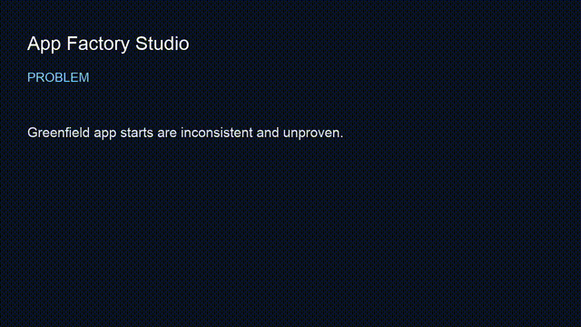

# app-factory-studio

> Spec paragraph → deterministic scaffold + prove gate.
**Outcome:** `app-factory prove` fails closed if required paths are missing, with smoke PASS as the recorded 60s proof result.


## Employer summary
`app-factory init` writes src/tests/proofs; `app-factory prove` is a static structure check that fails closed if required file paths are missing or are directories. It does not execute the generated app or tests.

## Proof in 60 seconds
```bash
git clone https://github.com/mrodgersjs-web/app-factory-studio.git
cd app-factory-studio
python3 -m pip install -e ".[test]"
bash scripts/smoke.sh
```

`app-factory prove` returns machine-readable `scope: "structure-only"`, `runtime_verified: false`, and `runtime_not_verified: true`; a PASS means the expected scaffold files exist as files, not that the generated runtime has been executed.

## Public boundary
See [docs/public-boundary.md](docs/public-boundary.md).

## Related
[proof-studio](https://github.com/mrodgersjs-web/proof-studio) · [fde-portfolio](https://github.com/mrodgersjs-web/fde-portfolio)


---


## Video walkthrough

- Script: [`docs/video-script.md`](docs/video-script.md)
- Recording: [`assets/demo.mp4`](assets/demo.mp4) (75s captioned)
- Preview: [`assets/demo.gif`](assets/demo.gif)



## FDE bar (this studio)

| Practice | Here |
| --- | --- |
| Employer summary | top of README |
| 60s / smoke proof | app-factory-studio smoke PASS |
| Public boundary |  |
| Claim under test | '"init+prove paths"' |
| Related fleet | [profile](https://github.com/mrodgersjs-web) · [resume](https://github.com/mrodgersjs-web/resume) · [patents teaser](https://github.com/mrodgersjs-web/patents) |

If app-factory-studio smoke PASS fails, the README claim is considered false until fixed.
